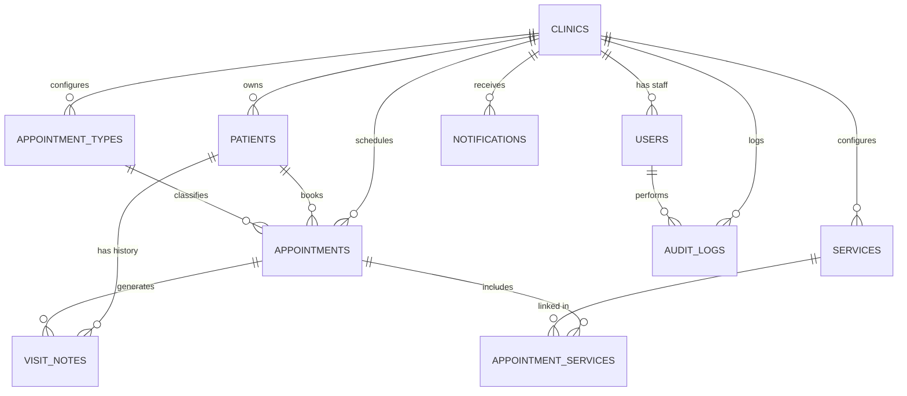
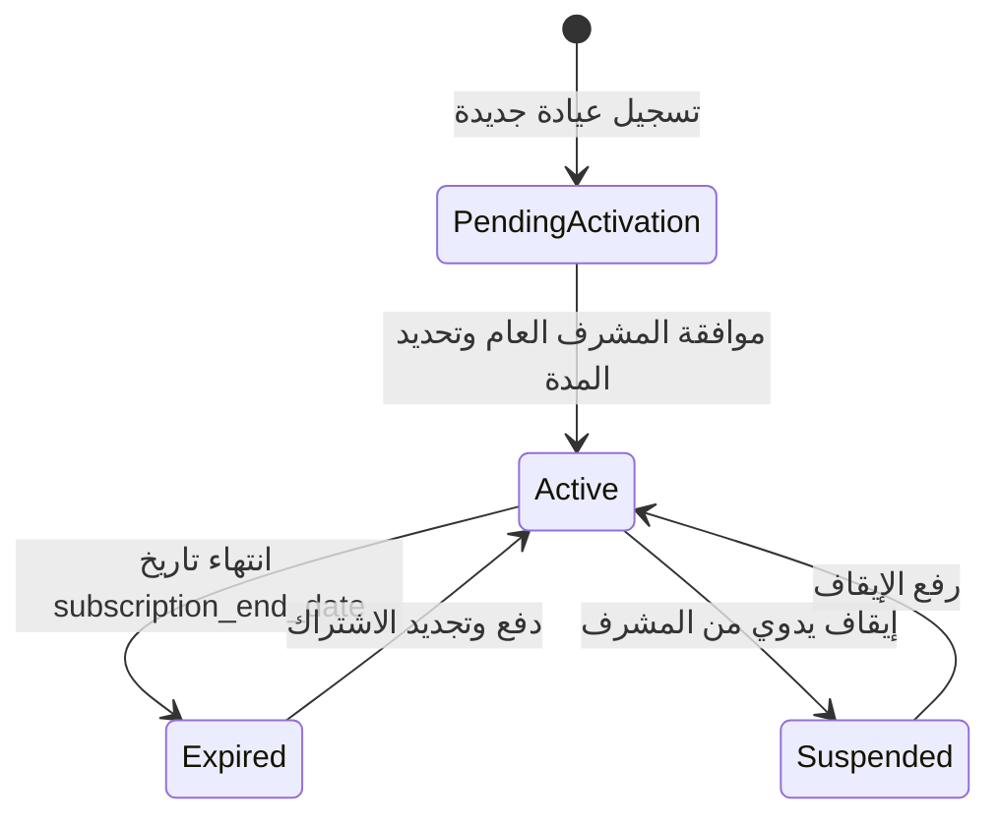

# 🗄️ دليل معمارية قاعدة البيانات والأمان (Database & Security Architecture)

هذا المستند هو المرجع التقني الشامل لبنية قاعدة بيانات **PostgreSQL (Supabase)**، وسياسات أمان صفوف البيانات (**RLS**)، ومصفوفة الصلاحيات، ودورة حياة الاشتراكات في نظام إدارة العيادات (`Eyadaty — عيادتي`).

---

## 🏗️ 1. المخطط العام ونموذج تعدد المستأجرين (Multi-Tenancy Architecture)

يعتمد النظام أسلوب **Shared Database, Shared Schema with Row-Level Security (RLS)**:
- جميع البيانات معزولة على مستوى المعرف `clinic_id`.
- لا يمكن لأي مستخدم (طبيب أو سكرتيرة) الوصول إلى أي سجل لا ينتمي إلى عيادته.
- يتم تطبيق سياسات RLS على مستوى نواة PostgreSQL لضمان الأمان التام حتى لو تم استدعاء الـ API مباشرة.

---

## 📊 2. الجداول الأساسية (Core Tables)

### 1️⃣ جدول العيادات `public.clinics` (Tenant Container)
يمثل الكيان الرئيسي لكل عيادة أو مركز طبي:
- `id` (UUID - PK): المعرف الفريد للعيادة.
- `name` (TEXT): اسم العيادة.
- `invite_code` (TEXT - UNIQUE): كود دعوة مكون من 6 رموز فريدة لانضمام السكرتارية أو الأطباء المساعدين.
- `subscription_status` (TEXT): حالة الاشتراك (`pending_activation`, `active`, `expired`, `suspended`).
- `subscription_end_date` (TIMESTAMPTZ): تاريخ ووقت نهاية الاشتراك الحالي.
- `is_active` (BOOLEAN): مفتاح تشغيل/إيقاف العيادة من قبل المشرف العام (Super Admin).
- `renewal_requested` (BOOLEAN): طلب تجديد باقة الاشتراك.
- `whatsapp_enabled` (BOOLEAN): حالة تفعيل خدمة إرسال رسائل الواتساب.
- `whatsapp_instance_name` (TEXT): اسم الـ Instance في Evolution API.
- `send_booking_message`, `send_reminder_message`, `send_cancellation_message` (BOOLEAN).
- `booking_message_template`, `reminder_message_template`, `cancellation_message_template` (TEXT): قوالب الرسائل القابلة للتخصيص.

---

### 2️⃣ جدول المستخدمين `public.users` (Staff & Roles)
مرتبط مباشرة بجدول المصادقة `auth.users(id)`:
- `id` (UUID - PK ⬅️ `auth.users.id`): معرف المستخدم.
- `clinic_id` (UUID - FK ⬅️ `clinics.id`): العيادة التابع لها.
- `role` (ENUM: `'doctor'`, `'secretary'`): دور المستخدم.
- `full_name` (TEXT): الاسم الكامل للمستخدم.
- `is_active` (BOOLEAN): حالة الحساب (يتيح للطبيب أو المشرف حظر أي موظف فورياً).
- **أعلام الصلاحيات الدقيقة للسكرتارية**:
  - `can_delete_appointments` (BOOLEAN): صلاحية حذف المواعيد نهائياً.
  - `can_view_reports` (BOOLEAN): صلاحية رؤية التقارير المالية والإيرادات.
  - `can_edit_services` (BOOLEAN): صلاحية إضافة وتعديل أسعار الكشوفات والخدمات.
  - `can_view_medical_history` (BOOLEAN): صلاحية الاطلاع على الروشتة والتاريخ المرضي والتشخيص.
  - `can_cancel_appointments` (BOOLEAN): صلاحية إلغاء الموعد.

---

### 3️⃣ جدول المرضى `public.patients`
- `id` (UUID - PK), `clinic_id` (UUID - FK ⬅️ `clinics.id`).
- `full_name` (TEXT): اسم المريض بالكامل.
- `phone` (TEXT): رقم الهاتف (المستخدم للتواصل ورسائل الواتساب).
- `gender` (TEXT: `'male'`, `'female'`): جنس المريض.
- `birth_date` (DATE): تاريخ الميلاد.
- `address` (TEXT): عنوان المريض ومحل الإقامة.
- `medical_history` (TEXT): التاريخ الطبي المرجعي والحساسية والأمراض المزمنة.
- `created_at`, `updated_at` (TIMESTAMPTZ).

---

### 4️⃣ جدول المواعيد `public.appointments`
- `id` (UUID - PK), `clinic_id` (UUID - FK ⬅️ `clinics.id`), `patient_id` (UUID - FK ⬅️ `patients.id`).
- `appointment_type_id` (UUID - FK ⬅️ `appointment_types.id`): نوع الكشف (أساسي، استشارة، إعادة).
- `appointment_date` (TIMESTAMPTZ): تاريخ وتوقيت الكشف.
- `status` (TEXT): حالة الموعد الحالية (`'pending'` [مع الطبيب], `'confirmed'` [في الانتظار], `'completed'` [منتهي], `'cancelled'`, `'cancelled_by_clinic'`, `'cancelled_by_patient'`).
- `price_charged` (NUMERIC): سعر الكشف المسجل للموعد.
- `created_at`, `updated_at` (TIMESTAMPTZ).

---

### 5️⃣ جدول الروشتات وملاحظات الفحص الطبي `public.visit_notes`
- `id` (UUID - PK), `clinic_id` (UUID - FK), `patient_id` (UUID - FK), `appointment_id` (UUID - FK UNIQUE).
- `notes` (TEXT): نص الفحص الطبي المنسق والمنفصل بواسطة فاصل الفصول `\n---\n` والذي يجمع:
  1. الشكوى الرئيسية (Chief Complaint)
  2. التشخيص الطبي (Diagnosis)
  3. الإرشادات والأدوية والروشتة (Instructions & Treatment)
- `created_at`, `updated_at` (TIMESTAMPTZ).

---

### 6️⃣ جدول الخدمات المقدمة في الموعد `public.appointment_services`
- `id` (UUID - PK), `clinic_id` (UUID - FK), `appointment_id` (UUID - FK), `service_id` (UUID - FK ⬅️ `services.id`).
- `price_charged` (NUMERIC): تكلفة الخدمة الإضافية المنفذة أثناء الفحص.
- `created_at`, `updated_at` (TIMESTAMPTZ).

---

### 7️⃣ جداول التدقيق والإشعارات
- `public.notifications`: إشعارات فورية للنظام (وصول مريض، اكتمال كشف، تجديد اشتراك).
- `public.audit_logs`: سجل أمني لا يقبل التعديل يوثق كافة العمليات الحساسة (الحذف، التعديل المالي، وتغيير الصلاحيات).

---

## 🔐 3. مصفوفة الصلاحيات وسياسات الأمان (RLS Policy Matrix)

| الكيان / الإجراء | الطبيب (Doctor) | السكرتيرة (Secretary) | الأساس البرمجي في RLS |
| :--- | :---: | :---: | :--- |
| **إدارة بيانات العيادة والإعدادات** | ✅ كاملة | ❌ محظور | `role = 'doctor'` |
| **ربط وتعيين إعدادات الواتساب** | ✅ كاملة | ❌ محظور | `role = 'doctor'` |
| **تسجيل المرضى وحجز المواعيد** | ✅ متاح | ✅ متاح | `clinic_id = my_clinic_id` |
| **إلغاء المواعيد** | ✅ متاح | ⚠️ حسب `can_cancel_appointments` | فحص علم الصلاحية في جدول المستخدمين |
| **حذف المواعيد نهائياً** | ✅ متاح | ⚠️ حسب `can_delete_appointments` | فحص علم الصلاحية في جدول المستخدمين |
| **رؤية وتعديل الروشتة والتاريخ الطبي** | ✅ كاملة | ⚠️ حسب `can_view_medical_history` | منع قراءة جدول `visit_notes` بدون الصلاحية |
| **تعديل أسعار الكشوفات والخدمات** | ✅ كاملة | ⚠️ حسب `can_edit_services` | RLS على جداول `services` و `appointment_types` |
| **عرض التقارير المالية والإيرادات** | ✅ كاملة | ⚠️ حسب `can_view_reports` | حماية الـ View `clinic_financial_reports` |

---

## 🔄 4. دورة حياة اشتراك العيادة (Subscription Lifecycle)

1. **`pending_activation`**: العيادة مسجلة حديثاً ولكنها تنتظر مراجعة وتفعيل المشرف العام (`subscription_end_date = now()`).
2. **`active`**: العيادة تعمل بكامل الميزات وخدماتها متاحة للمستخدمين.
3. **`expired`**: انتهت فترة الاشتراك، يظهر التطبيق شاشة حجب الاشتراك (`SubscriptionGateScreen`) وتتاح فقط نافذة طلب التجديد.
4. **`suspended`**: إيقاف إداري يمنع تسجيل الدخول واستخدام النظام.

---

## ⚡ 5. الدوال التلقائية والـ Triggers

1. **`handle_new_user()`**:
   - يتم تشغيلها تلقائياً عند إنشاء مستخدم جديد في `auth.users`.
   - تنشئ سجلاً في `public.users`، وتقوم إما بإنشاء عيادة جديدة وتعيين المستخدم كطبيب مالك، أو ربطه بعيادة قائمة عبر كود الدعوة `invite_code`.
2. **`update_updated_at_column()`**:
   - تحديث حقل `updated_at` تلقائياً في كل الجداول عند إجراء أي تعديل.
3. **`is_my_user_active()`**:
   - دالة أمان سريعة تُفحص داخل سياسات RLS للتأكد من أن حساب المستخدم لم يتم حظره (`is_active = true`) قبل تنفيذ أي عملية.
