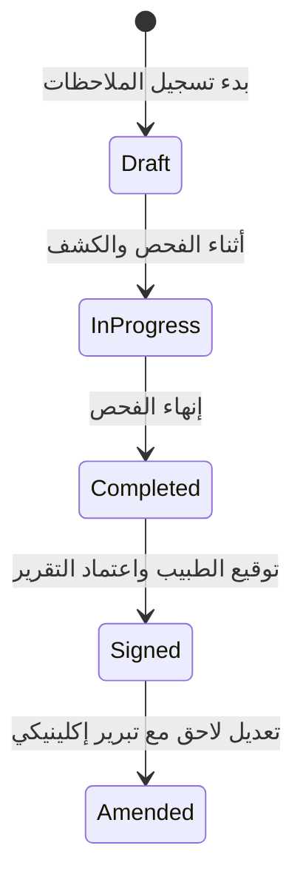

# 🏥 وثيقة المواصفات والمعمارية الشاملة — المرحلة الثانية (Phase 2: Specialty EMRs, Multi-Doctor & Multi-Branch Architecture)

هذا المستند يُعد المرجع الهندسي، الطبي، والتقني الكامل لتطوير **المرحلة الثانية (Phase 2)** لنظام **عيادتي (Eyadaty SaaS)**. تم تصميم هذه المرحلة لتحويل النظام إلى منصة طبية سحابية متقدمة (**Production-Grade Healthcare SaaS**) تدعم **تعدد الفروع**، **تعدد الأطباء**، وتوفر **مساحات عمل إكلينيكية مخصصة لكل تخصص طبي (Specialty Clinical Workspaces)** تلبي احتياجات الأطباء الواقعية في مصر والشرق الأوسط مع مراعاة الأدلة الإرشادية للمجلس الصحي المصري وهيئة الدواء المصرية (EDA).

---

## 🏛️ 1. المعمارية الهندسية للنظام (Decoupled Core vs Specialty Engines)

تعتمد البنية على فصل **المحرك الأساسي المشترك (Core EMR Engine)** عن **محركات التخصصات الطبية (Specialty Engines)**. هذا الفصل يضمن إضافة تخصصات جديدة لاحقاً (مثل: الجلدية، القلب، النساء والتوليد، الأسنان، العظام) كـ **Specialty Packs** مستقلة تماماً دون المساس باستقرار النظام أو إعادة بناء الجداول الأساسية.

```
                                  Eyadaty Healthcare SaaS
                                             │
                  ┌──────────────────────────┴──────────────────────────┐
                  │                                                     │
       Specialty Clinical Engines                              Core Platform Engine
                  │                                                     │
     ┌────────────┼────────────┬─────────────┬─────────────┐            ├─ Multi-Tenancy (Clinics)
     │            │            │             │             │            ├─ Multi-Branch (Branches)
👶 Pediatrics 👁️ Ophtha   🩺 Int. Med  🫁 Pulmo   🐕 Vet Pack       ├─ Multi-Doctor (RBAC)
     │            │            │             │             │            ├─ Patients Registry
     ├─ Growth    ├─ VA/Refract├─ HPI Builder├─ Asthma/COPD├─ Animal/Own├─ Appointments & Queue
     ├─ Vaccines  ├─ IOP Graph ├─ Chronic Dash├─ Spiro PFT ├─ Parasites ├─ Visit State & Signing
     ├─ Milestones├─ Slit Lamp ├─ Lab Orders ├─ Inhalers   ├─ Species Rx├─ Immutable Audit Trail
     └─ Wt-based  └─ Fundus    └─ Rx History └─ Chest Img  └─ Weight Rx └─ Billing & WhatsApp
```

---

## 🏢 2. البنية التحتية لتعدد الفروع وتعدد الأطباء (Multi-Branch & Multi-Doctor Core)

### 1️⃣ الهيكل الهرمي للمؤسسة الطبية:
- **المؤسسة / العيادة (`Clinic Organization`)**: الحاوية السحابية للاشتراك، الفواتير، وإعدادات العلامة التجارية.
- **الفروع (`Branches`)**: فروع جغرافية متعددة (الفرع الرئيسي، المهندسين، التجمع، الإسكندرية...)، كل فرع له طابوره الخاص، سكرتاريته، ومواعيده.
- **الأطباء وطاقم العمل (`Users & Staff`)**:
  - **طبيب مالك (Owner Doctor)**: إدارة كافة الفروع، رؤية التقارير المجمعة والتفصيلية، والتحكم في إعدادات العيادة.
  - **أطباء مشاركون وأخصائيون (Associate / Specialist Doctors)**: العمل في فرع أو فروع محددة مع طابور مخصص وتقارير دخل فردية.
  - **السكرتارية والاستقبال (Branch Receptionists)**: إدارة طابور واستقبال الفرع المخصص.

### 2️⃣ مبدل الفروع الذكي (Global Branch Switcher):
- قائمة سريعة في رأس الواجهة للتبديل اللحظي بين الفروع، مع خيار **"كل الفروع (All Branches)"** للطبيب المالك.
- فلترة متزامنة لبيانات الطابور والمواعيد والتقارير المالية بناءً على الفرع النشط.

---

## 🩺 3. مواصفات مساحات العمل الإكلينيكية (The 5 Specialty Workspaces)

كل تخصص يمتلك **Clinical Workspace** مستقل ومصمم لإنهاء الزيارة في دقائق مع توثيق عميق للبيانات:

---

### 👶 أولاً: طب الأطفال (Pediatrics Specialty Workspace)

#### 1. شريط ترويسة الطفل (Patient Header & Clinical Alerts):
- اسم الطفل، العمر الدقيق بالسنوات والشهور والأيام (مثال: `3 سنوات و 4 شهور`).
- الجنس، الوزن الحالي، آخر زيارة، الحساسية الدوائية (Penicillin، إلخ).
- **شارات التنبيهات اللحظية**:
  - 🔴 **Drug Allergy** (حساسية دوائية مهددة).
  - 🟠 **Chronic Condition** (مرض مزمن: ربو أطفال، سكري أطفال، أنيميا البحر المتوسط).
  - 🟡 **Vaccination Due / Overdue** (تطعيم مستحق أو متأخر).
  - 🔵 **Growth Concern** (انحراف في منحنى النمو أو الوزن).

#### 2. النمو والمؤشرات الحيوية (Growth & Vitals Module):
- **القياسات**: الوزن (Weight)، الطول/الارتفاع (Height/Length)، محيط الرأس (Head Circumference)، مؤشر كتلة الجسم (BMI)، الحرارة (Temp)، النبض (HR)، معدل التنفس (RR)، نسبة الأكسجين (SpO₂)، ضغط الدم.
- **الحسابات التلقائية**:
  - `Weight-for-age Percentile & Z-score`
  - `Height-for-age Percentile & Z-score`
  - `BMI-for-age Percentile & Z-score`
  - `Head Circumference-for-age Percentile`
- **منحنى النمو التفاعلي (Interactive Growth Chart)**:
  - رسم بياني زمني يوضح مسار نمو الطفل عبر الزيارات السابقة ومقارنته بمنحنيات منظمة الصحة العالمية (WHO Growth Charts):
  > مسار الوزن: `12.1 kg ⬅️ 12.8 kg ⬅️ 13.5 kg ⬅️ 14.2 kg`

#### 3. التاريخ المرضي للأطفال (Pediatric History & HPI):
- **الشكوى الرئيسية (Chief Complaint)**: أزرار سريعة للأعراض الأكثر شيوعاً (Fever, Cough, Vomiting, Diarrhea, Abdominal pain, Poor feeding, Rash, Ear pain, Sore throat, Dyspnea, Convulsion, Headache) مع محرك بحث ونص حر.
- **مُفصّل الأعراض الإكلينيكي (Structured HPI Helpers)**:
  - *الحرارة (Fever)*: البداية (Onset)، المدة، أقصى درجة مسجلة، طريقة القياس، متقطعة/مستمرة، الاستجابة لخافضات الحرارة، الأعراض المصاحبة.
  - *السعال (Cough)*: المدة، جاف/مصاحب ببلغم، ليلي، مصحوب بأزيز (Wheezing)، صعوبة تنفس، قيء بعد السعال.
- **تاريخ الولادة (Birth History)**: العمر الرحمي (Gestational age / Preterm)، وزن الولادة، نوع الولادة (طبيعي / قيصري)، دخول الحضانة (NICU)، الصفراء الوليدية، مضاعفات التنفس.
- **التطور الحركي والذهني (Developmental Milestones)**:
  - الحركية الكبرى (Gross Motor)، الحركية الدقيقة (Fine Motor)، اللغة والتواصل (Language)، التفاعل الاجتماعي (Social).
  - الحالات: `Achieved` | `Delayed` | `Not Assessed` مع جدول زمني لمراحل التطور.
- **التغذية والرضاعة (Nutrition Module)**:
  - طبيعية (Breastfeeding)، صناعية (Formula)، مختلطة، طعام صلب (Solids)، الشهية، صعوبات الرضاعة، حساسية الطعام، عدد الرضعات وحجم الرضعة للأطفال الرضع.

#### 4. سجل التطعيمات الرقمي (Vaccination Management):
- جدول التطعيمات الإلزامية والإضافية: اسم اللقاح، رقم الجرعة، تاريخ الإعطاء، طريق الإعطاء (عضلي/فموي)، مكان الحقن، رقم التشغيلة (Batch #)، وتاريخ الجرعة التالية.
- حالات التطعيم: `Given` (تم الإعطاء) | `Due` (مستحق) | `Overdue` (متأخر) | `Refused` (مرفوض) | `Contraindicated` (ممنوع طبياً).

#### 5. الفحص الإكلينيكي للأطفال (Pediatric Physical Exam):
- **General**: درجة الوعي، النشاط، الجفاف (Hydration status)، الشحوب، الصفراء، الزرقة، التورم، الغدد الليمفاوية.
- **ENT**: الأذن (Tympanic membrane)، الأنف، الحلق، اللوزتين (Tonsils grading).
- **Chest**: دخول الهواء (Air entry)، الأزيز (Wheezes)، الخراخر (Crackles)، علامات ضيق التنفس (Retractions, Grunting).
- **CVS**: أصوات القلب، اللغط (Murmurs)، النبض الطرفي، زمن امتلاء الشعيرات (CRT).
- **Abdomen**: البطن (Soft/Distended)، الألم، تضخم الكبد/الطحال (Organomegaly)، أصوات الأمعاء.
- **Neurological**: التوتر العضلي (Tone)، الانعكاسات (Reflexes)، القوة العضلية، التشنجات.

#### 6. الروشتة وحساب الجرعات بالأوزان (Weight-Based Prescription):
- بحث ذكي في قاعدة الأدوية مع حاسبة الجرعة بالأوزان (`mg/kg/dose` و `mg/kg/day`).
- إظهار تركيز الدواء، الجرعة، وحدة الجرعة، التكرار، المدة، وطريقة الاستخدام مع ترك القرار النهائي للطبيب المعالج.

---

### 👁️ ثانياً: طب وجراحة العيون (Ophthalmology Specialty Workspace)

#### 1. ترويسة مريض الرمد (Ophthalmic Header):
- بيانات المريض، قياس النظارة الحالي (Current Glasses Rx)، الحساسية، والتشخيص السابق لكل عين بشكل مستقل (`OD` العين اليمنى، `OS` العين اليسرى).

#### 2. حدة الإبصار (Visual Acuity Grid):
- جدول مقارن للعينين: `Right (OD)` | `Left (OS)` | `Both (OU)`.
- القياسات للمسافات البعيدة (Distance) والقريبة (Near):
  - بدون تصحيح (Without correction / Uncorrected VA).
  - بالنظارة الحالية (With current correction).
  - باستخدام ثقب الدبوس (Pinhole VA).

#### 3. انكسار العين والروشتة البصرية (Refraction & Final Glasses Rx):
- **القياس الانكساري (Refraction)** لكل عين: `Sphere`, `Cylinder`, `Axis`, `Add`, `Prism`, `Base`.
- **روشتة النظارة النهائية (Final Prescription)**:
  - قياس المسافة بين البؤبؤين للمسافات والقراءة (`PD` & `Near PD`).
  - نوع العدسة (Single Vision, Bifocal, Progressive)، خامة العدسة، والطبقات العاكسة (Coatings).

#### 4. ضغط العين والحدقة وحركة العين (IOP, Pupils, EOM):
- **ضغط العين (IOP)**: تسجيل قياس `OD` و `OS` مع طريقة القياس (Goldmann, Non-contact, Perkins)، الوقت، والجهاز، مع **رسم بياني زمني لتتبع ضغط العين عبر الزيارات (IOP Trend Graph)** لاكتشاف ومتابعة الجلوكوما.
- **الحدقة (Pupils)**: الحجم، الاستجابة للضوء، وعيب الحدقة الوارد النسبي (`RAPD`).
- **حركة عضلات العين الخارجية (Extraocular Movements)**: المدى (Full / Restricted)، الرؤية المزدوجة (Diplopia)، الألم، ووجود حول (Strabismus).

#### 5. فحص المصباح الشقي وقاع العين (Slit Lamp & Fundus Exam):
- **Slit Lamp Exam**:
  - *Lids*: سليم، تورم، أكياس دهنية، تدلي (Ptosis).
  - *Conjunctiva*: سليمة، احتقان (Injection)، ارتشاح (Chemosis)، إفرازات.
  - *Cornea*: رائقة (Clear)، وذمة (Edema)، قرحة (Ulcer)، عتامة، صبغة الفلوريسين (Fluorescein staining).
  - *Anterior Chamber*: عميقة ورائقة، خلايا (Cells grading)، وميض (Flare)، صديد (Hypopyon).
  - *Iris & Lens*: القزحية، والعدسة (Clear, Cataract grading, Pseudophakia/IOL).
- **Fundus Exam (قاع العين)**:
  - *Optic Disc*: نسبة التقعر للقرص (`C/D ratio`)، وذمة القرص (Papilledema)، الشحوب (Pallor).
  - *Macula*: سليمة، وذمة مركز الإبصار (Macular Edema)، ارتشاحات، ثقب.
  - *Retina & Vessels*: انفصال شبكي، نزيف (Hemorrhages)، اعتلال سكري أو ضغطي، انسداد وريدي/شرياني.

#### 6. الفحوصات والتقارير التصويرية (Ophthalmic Diagnostic Tests):
- قسم مخصص لفحوصات: `OCT Macula`, `OCT RNFL / Glaucoma`, `Visual Field (Perimetry)`, `Fundus Photography`, `Corneal Topography (Pentacam)`, `Pachymetry`, `Biometry (IOL Master)`.
- إمكانية إرفاق الصور وتقارير الـ PDF وربطها بالزيارة مع استعراضها جنباً إلى جنب مع الفحص.

#### 7. التسلسل الزمني المقارن للرمد (Ophthalmology Comparison Timeline):
- استعراض القيم السابقة بجانب الحالية فورياً:
  > حدة الإبصار: `VA OD: 6/12 (Current) ⬅️ 6/18 (Previous)`
  > ضغط العين: `IOP OD: 18 mmHg (Current) ⬅️ 22 mmHg (Previous)`

---

### 🩺 ثالثاً: الأمراض الباطنة العامة (Internal Medicine Workspace)

#### 1. التاريخ المرضي المفصل ومُنشئ الشكوى (HPI & Medical History):
- **مُنشئ الشكوى الذكي (HPI Builder)**: البداية (Onset)، المكان (Location)، المدة، الطبيعة (Character: Burning, Throbbing, Cramping...)، الانتشار (Radiation)، الشدة (1-10)، العوامل المهدئة والمثيرة، والأعراض المصاحبة.
- **سجل الأمراض المزمنة (Past Medical History)**:
  - السكري (Diabetes)، الضغط (Hypertension)، القصور الكلوي (CKD)، أمراض القلب والشرايين، أمراض الكبد، اضطرابات الغدة الدرقية، السكتات الدماغية السابقة، الأورام.
  - توثيق: تاريخ التشخيص، الحالة الحالية، الخطة العلاجية الحالية.

#### 2. السجل الدوائي الشامل (Comprehensive Medication History):
- **Active Medications**: الأدوية النشطة، الجرعات، ومواعيدها وتاريخ بدئها.
- **Discontinued Medications**: الأدوية الموقوفة مع توثيق سبب الإيقاف وتاريخه.
- **Previous Adverse Reactions**: استجابة المريض السابقة والآثار الجانبية.

#### 3. العلامات الحيوية ومخطط ضغط الدم (Vitals & BP Tracker):
- قياس ضغط الدم بتفاصيله: الانقباضي (Systolic)، الانبساطي (Diastolic)، الوضعية (Sitting/Standing)، والذراع (Right/Left Arm).
- **رسم بياني لضغط الدم والوزن ومؤشر كتلة الجسم (BMI Trend)** عبر الزيارات.

#### 4. دورة طلبات الفحوصات المعملية (Lab Orders Lifecycle):
- إدارة التحاليل الطبية بنظام دورة حياة واضح:
  > `Ordered (تم الطلب)` ⬅️ `Pending (قيد الانتظار)` ⬅️ `Result Received (تم استلام النتيجة)` ⬅️ `Reviewed & Signed by Doctor (تمت مراجعتها)`
- حقول لنتائج التحاليل الشائعة: `CBC`, `HbA1c`, `Fasting Glucose`, `Serum Creatinine`, `Urea`, `eGFR`, `ALT/AST`, `Lipid Profile`, `TSH`, `Urine Albumin/Creatinine Ratio`.
- مقارنة تلقائية لنتائج التحاليل السابقة والحالية لاكتشاف التغيرات الإيجابية أو السلبية فورياً.

#### 5. لوحة متابعة الأمراض المزمنة (Chronic Disease Dashboard):
- لوحة بصرية مخصصة لمتابعة استجابة مريض السكري، الضغط، أو الكلى:
  > تتبع السكر التراكمي: `HbA1c: 8.4% ⬅️ 7.9% ⬅️ 7.1% ⬅️ 6.8%`
  > وظائف الكلى: `Creatinine: 1.6 ⬅️ 1.4 ⬅️ 1.2 mg/dL`

---

### 🫁 رابعاً: أمراض الصدر والجهاز التنفسي (Pulmonology Workspace)

#### 1. تقييم الأعراض التنفسية وسجل التدخين (Respiratory History & Smoking Index):
- **أعراض الصدر**: السعال، ضيق التنفس (Dyspnea)، الأزيز (Wheezing)، البلغم (Sputum)، البصاق المدمم (Hemoptysis)، ألم الصدر، الأعراض الليلية، ومحدودية المجهود البدني.
- **تحليل السعال والبلغم**: المدة، جاف/مصحوب ببلغم، لون البلغم، الكمية، وجود دم، التغيرات الموسمية والمحفزات (Triggers).
- **مؤشر التدخين الدقيق (Smoking Index)**:
  - التصنيف: `Current Smoker` | `Ex-Smoker` | `Never Smoker`.
  - الحساب التلقائي لعدد سنوات العبوات: `Pack-Years = (Cigarettes/day ÷ 20) × Years of smoking`.
  - توثيق تاريخ الإقلاع (Quit date) والتدخين الإلكتروني (Vaping / Shisha).

#### 2. وحدات الربو والسدة الرئوية المزمنة (Asthma & COPD Modules):
- **Asthma Control Tracking**:
  - تاريخ التشخيص، المحفزات، الأعراض النهارية والليلية، معدل استخدام البخاخ الإسعافي (Rescue Inhaler)، نوبات التدهور الحادة (Exacerbations/year)، ودخول المستشفى أو الرعاية المركزة (ICU).
- **COPD Assessment (GOLD Guidelines)**:
  - عدد نوبات التدهور سنوياً، مقياس ضيق التنفس (`mMRC Dyspnea Scale`) ومقياس تقييم السدة الرئوية (`CAT Score`)، الاحتياج للأكسجين المنزلي، ونوع العلاج الاستنشاقي.

#### 3. فحص وظائف التنفس والسبيرومتري (PFT & Spirometry Results):
- جدول منظم لنتائج وظائف الرئة:
  - `FVC`, `FEV1`, `FEV1/FVC Ratio`, `PEF`, `FEF 25-75%`.
  - القيم المتوقعة (Predicted)، المقاسة (Measured)، والنسبة المئوية (`% Predicted`).
  - اختبار الاستجابة لموسعات الشعب (`Post-Bronchodilator Reversibility`).
  - مقارنة زمنيّة لنتائج الـ Spirometry عبر الزيارات السابقة.

#### 4. الأدوية وأجهزة الاستنشاق الصدرية (Inhaler & Respiratory Therapy):
- توثيق أجهزة الاستنشاق: نوع الجهاز (MDI, DPI, Respimat, Nebulizer)، الجرعة، التكرار، وملاحظات الطبيب حول صحة تقنية الاستنشاق للمريض (Inhalation Technique Assessment).
- أرشفة تقارير أشعة الصدر (`Chest X-Ray`, `CT Chest`, `HRCT`).

---

### 🐕 خامساً: الطب البيطري (Veterinary Medicine Workspace)

معمارية مختلفة تماماً تراعي فصل كيان **الحيوان الأليف (Animal Entity)** عن كيان **المالك (Owner Entity)**:

#### 1. بطاقة الحيوان الأليف والمالك (Animal Profile & Owner Header):
- **بيانات الحيوان**: الاسم، النوع (Species: كلب، قط، خيل، طيور...)، السلالة (Breed)، الجنس، العمر التقديري/تاريخ الميلاد، اللون، العلامات المميزة، رقم الشريحة الإلكترونية (`Microchip ID`)، وحالة التعقيم (Neutered / Spayed).
- **بيانات المالك**: الاسم، الهاتف، العنوان، رقم الطوارئ، وسجل الحيوانات الأخرى المملوكة لنفس المالك.

#### 2. الفحص الإكلينيكي البيطري (Veterinary Physical Exam):
- درجة الحرارة الشرجية، معدل النبض والقلب، معدل التنفس، الوزن، ومقياس الحالة الجسدية (`Body Condition Score - BCS 1-9`).
- الأغشية المخاطية (Mucous membranes: Pink, Pale, Icteric, Cyanotic)، زمن امتلاء الشعيرات الدموية (`CRT < 2s`)، حالة الجفاف، والغدد الليمفاوية.
- الفحص الجهازي: الجلد والفراء، العيون، الأذنان، الفم والأسنان، الجهاز الهضمي، العضلي الهيكلي، والعصبي.

#### 3. الطب الوقائي ومكافحة الطفيليات (Vaccinations & Parasite Control):
- سجل تطعيمات الحيوانات: اسم اللقاح، تاريخ الإعطاء، رقم التشغيلة، الشركة المصنعة، وموعد الجرعة التالية.
- برامج مكافحة الطفيليات: تجريع الديدان (Deworming)، مكافحة البراغيث والقراد (Flea & Tick Prevention)، وديدان القلب (Heartworm).

#### 4. الأدوية البيطرية وحساب الجرعات (Species & Weight-Based Veterinary Rx):
- صرف الأدوية المعتمدة بيطرياً مع حساب الجرعة بالمليجرام/كجم (`mg/kg`) مع مراعاة نوع وفصيلة الحيوان وحظر الأدوية السامة لأنواع معينة.

---

## ⚡ 4. ركائز النظام السحابي الطبية المشتركة (Core Production SaaS Features)

تتواجد هذه الميزات في كافة التخصصات كجزء من معمارية النظام الأساسية:

### 1️⃣ الحفظ التلقائي والمسودات (Draft & Auto-Save):
- حفظ لحظي تلقائي لكل حرف يُكتب في خلفية التطبيق (`Autosaved at 10:42 AM`).
- إغلاق المتصفح أو انقطاع الاتصال يحفظ الزيارة كمسودة (`Draft`) قابلة للاستئناف فوراً دون فقدان أي كلمة.

### 2️⃣ دورة حياة الزيارة والاعتماد الطبي (Visit Lifecycle & Signing):

- بعد توقيع الزيارة (`Signed`)، يُقفل السجل الطبي تماماً لمنع أي تعديل صامت.
- في حال استدعت الحاجة تعديل تشخيص أو جرعة بعد التوقيع، يتم إنشاء **ملحق تعديلي (`Amendment`)** يوثق سبب التعديل وتوقيته واسم الطبيب في سجل التدقيق.

### 3️⃣ سجل التدقيق الأمني الطبي (Immutable Audit Trail):
- تسجيل غير قابل للتعديل لكافة الإجراءات الحساسة:
  > *"د. أحمد قام بتعديل قراءة الضغط من 150/90 إلى 140/90 بتاريخ 22/08/2026 الساعة 11:42 مع ذكر السبب: إعادة قياس بعد راحة 10 دقائق."*

### 4️⃣ الخط الزمني الموحد للمريض (Unified Patient Timeline):
- شريط تاريخي موحد يجمع كافة أحداث المريض في مكان واحد: الزيارات، التشخيصات، الروشتات، التحاليل المعملية، وصور الأشعة، وتعديلات الأدوية.

### 5️⃣ القوالب الجاهزة المخصصة (Specialty Clinical Templates):
- قوالب سريعة قابلة للتطبيق بنقرة واحدة داخل كل تخصص، مثل:
  - *أطفال*: قالب نزلة معوية حادة (Acute Gastroenteritis)، التهاب أذن وسطى، فحص دوري لحديثي الولادة.
  - *رمد*: متابعة جلوكوما، فحص مياه بيضاء، فحص جفاف العين، مقاس نظارة.
  - *باطنة*: متابعة سكري نوع ثاني، نوبة ارتفاع ضغط، التهاب مسالك بولية.
  - *صدر*: متابعة ربو شعبي، نوبة تفاقم سدة رئوية، سعال مزمن.
- إمكانية إنشاء وتخصيص قوالب جديدة من قبل الطبيب وحفظها في حسابه.

### 6️⃣ البحث الذكي عن الأدوية (Smart Drug Search & Egyptian Drug Database):
- محرك بحث بالاسم التجاري (Brand)، الاسم العلمي (Generic)، أو المادة الفعالة (Active Ingredient).
- توافق مع تصنيفات وقوائم هيئة الدواء المصرية (EDDB).

### 7️⃣ التنبيهات الإكلينيكية الذكية (Clinical Safety Alerts):
- 🔴 **Allergy Conflict**: تنبيه فوري عند كتابة دواء يحتوي على مادة يعاني المريض من حساسية مسجلة تجاهها.
- 🟡 **Medication Duplicate**: تنبيه عند تكرار نفس المادة الفعالة أو الصنف الدوائي.
- 🔵 **Follow-up Overdue**: تنبيه عند تخلف المريض عن موعد الاستشارة المحدد له.

---

## 🗄️ 5. مخطط قاعدة البيانات لمرحلة Phase 2 (Hybrid Relational + Specialty Schema)

```sql
-- 1. جدول الفروع
CREATE TABLE public.branches (
    id uuid PRIMARY KEY DEFAULT gen_random_uuid(),
    clinic_id uuid NOT NULL REFERENCES public.clinics(id) ON DELETE CASCADE,
    name text NOT NULL,
    phone text,
    address text,
    is_active boolean NOT NULL DEFAULT true,
    whatsapp_phone text,
    whatsapp_instance_name text,
    created_at timestamptz NOT NULL DEFAULT now(),
    updated_at timestamptz NOT NULL DEFAULT now()
);

-- 2. جدول ربط المستخدمين بالفروع
CREATE TABLE public.user_branches (
    id uuid PRIMARY KEY DEFAULT gen_random_uuid(),
    user_id uuid NOT NULL REFERENCES public.users(id) ON DELETE CASCADE,
    branch_id uuid NOT NULL REFERENCES public.branches(id) ON DELETE CASCADE,
    clinic_id uuid NOT NULL REFERENCES public.clinics(id) ON DELETE CASCADE,
    is_primary boolean NOT NULL DEFAULT false,
    created_at timestamptz NOT NULL DEFAULT now(),
    UNIQUE(user_id, branch_id)
);

-- 3. تحديث جدول المواعيد
ALTER TABLE public.appointments 
ADD COLUMN IF NOT EXISTS branch_id uuid REFERENCES public.branches(id) ON DELETE SET NULL,
ADD COLUMN IF NOT EXISTS doctor_id uuid REFERENCES public.users(id) ON DELETE SET NULL;

-- 4. جدول السجلات الطبية للزيارات (Core Clinical Visits)
CREATE TABLE public.clinical_visits (
    id uuid PRIMARY KEY DEFAULT gen_random_uuid(),
    clinic_id uuid NOT NULL REFERENCES public.clinics(id) ON DELETE CASCADE,
    branch_id uuid REFERENCES public.branches(id) ON DELETE SET NULL,
    appointment_id uuid UNIQUE REFERENCES public.appointments(id) ON DELETE CASCADE,
    patient_id uuid NOT NULL REFERENCES public.patients(id) ON DELETE CASCADE,
    doctor_id uuid NOT NULL REFERENCES public.users(id) ON DELETE CASCADE,
    specialty text NOT NULL CHECK (specialty IN ('pediatrics', 'ophthalmology', 'internal_medicine', 'pulmonology', 'veterinary', 'general')),
    visit_status text NOT NULL DEFAULT 'draft' CHECK (visit_status IN ('draft', 'in_progress', 'completed', 'signed', 'amended')),
    chief_complaint text,
    diagnosis_primary text,
    diagnosis_secondary text,
    treatment_plan text,
    clinical_data jsonb NOT NULL DEFAULT '{}'::jsonb, -- يحتوي على الحقول العميقة الخاصة بالتخصص
    follow_up_date date,
    follow_up_instructions text,
    is_signed boolean NOT NULL DEFAULT false,
    signed_at timestamptz,
    signed_by uuid REFERENCES public.users(id),
    created_at timestamptz NOT NULL DEFAULT now(),
    updated_at timestamptz NOT NULL DEFAULT now()
);

-- 5. جدول طلبات التحاليل والفحوصات
CREATE TABLE public.diagnostic_orders (
    id uuid PRIMARY KEY DEFAULT gen_random_uuid(),
    clinic_id uuid NOT NULL REFERENCES public.clinics(id) ON DELETE CASCADE,
    visit_id uuid NOT NULL REFERENCES public.clinical_visits(id) ON DELETE CASCADE,
    patient_id uuid NOT NULL REFERENCES public.patients(id) ON DELETE CASCADE,
    test_type text NOT NULL, -- 'lab', 'imaging', 'ophthalmic_oct', 'spirometry'
    test_name text NOT NULL,
    status text NOT NULL DEFAULT 'ordered' CHECK (status IN ('ordered', 'pending', 'received', 'reviewed')),
    results_payload jsonb,
    attachments_urls text[],
    doctor_comments text,
    created_at timestamptz NOT NULL DEFAULT now(),
    updated_at timestamptz NOT NULL DEFAULT now()
);

-- 6. جدول سجلات التطعيمات
CREATE TABLE public.patient_vaccinations (
    id uuid PRIMARY KEY DEFAULT gen_random_uuid(),
    clinic_id uuid NOT NULL REFERENCES public.clinics(id) ON DELETE CASCADE,
    patient_id uuid NOT NULL REFERENCES public.patients(id) ON DELETE CASCADE,
    vaccine_name text NOT NULL,
    dose_number int NOT NULL DEFAULT 1,
    administered_date date,
    next_due_date date,
    status text NOT NULL DEFAULT 'due' CHECK (status IN ('given', 'due', 'overdue', 'refused', 'contraindicated')),
    batch_number text,
    administered_by uuid REFERENCES public.users(id),
    notes text,
    created_at timestamptz NOT NULL DEFAULT now()
);

-- 7. جدول الحيوانات الأليفة (خاص بالتخصص البيطري)
CREATE TABLE public.veterinary_animals (
    id uuid PRIMARY KEY DEFAULT gen_random_uuid(),
    clinic_id uuid NOT NULL REFERENCES public.clinics(id) ON DELETE CASCADE,
    owner_patient_id uuid NOT NULL REFERENCES public.patients(id) ON DELETE CASCADE,
    animal_name text NOT NULL,
    species text NOT NULL,
    breed text,
    gender text CHECK (gender IN ('male', 'female', 'neutered_male', 'spayed_female')),
    birth_date date,
    microchip_id text,
    color_marks text,
    created_at timestamptz NOT NULL DEFAULT now(),
    updated_at timestamptz NOT NULL DEFAULT now()
);

-- 8. جدول التدقيق الطبي الصارم (Clinical Audit Trail)
CREATE TABLE public.clinical_audit_logs (
    id uuid PRIMARY KEY DEFAULT gen_random_uuid(),
    clinic_id uuid NOT NULL REFERENCES public.clinics(id) ON DELETE CASCADE,
    entity_type text NOT NULL, -- 'clinical_visit', 'prescription', 'vitals', 'orders'
    entity_id uuid NOT NULL,
    user_id uuid NOT NULL REFERENCES public.users(id),
    action text NOT NULL, -- 'created', 'updated', 'signed', 'amended'
    change_reason text,
    old_data jsonb,
    new_data jsonb,
    ip_address text,
    created_at timestamptz NOT NULL DEFAULT now()
);
```

---

## 🗺️ 6. خطة ومراحل التنفيذ (Implementation Roadmap)

| المرحلة | المحتوى والمهام |
| :--- | :--- |
| **المرحلة 2.1** | **تحديث قاعدة البيانات في Supabase**: إنشاء جداول الفروع، تحديث المواعيد، وجداول `clinical_visits` مع حقول الـ JSONB المهيكلة لكل تخصص، وسياسات RLS. |
| **المرحلة 2.2** | **بنية تعدد الفروع والأطباء في الواجهة**: إنشاء `BranchSwitcherWidget`، وتحديث شاشات المواعيد والداشبورد لاختيار الطبيب والفرع مع تصفية البيانات. |
| **المرحلة 2.3** | **بناء مساحة عمل طب الأطفال (Pediatrics Workspace)**: مخطط النمو WHO، سجل التطعيمات، التاريخ المرضي المفصل، وحساب الجرعات بالأوزان. |
| **المرحلة 2.4** | **بناء مساحة عمل طب وجراحة العيون (Ophthalmology Workspace)**: شبكة انكسار العين `OD/OS`، حدة الإبصار، مخطط ضغط العين `IOP`، وفحص المصباح وقاع العين. |
| **المرحلة 2.5** | **بناء مساحة عمل الباطنة والصدر (Internal Med & Pulmonology)**: مُنشئ HPI، سجل الأدوية، دورة التحاليل، مؤشر التدخين، ونتائج السبيرومتري `PFT`. |
| **المرحلة 2.6** | **بناء مساحة عمل الطب البيطري (Veterinary Workspace)**: فصل كيان الحيوان عن المالك، مقياس BCS، مكافحة الطفيليات، والجرعات الخاصة بالفصائل. |
| **المرحلة 2.7** | **ركائز الإنتاجية والأمان**: نظام الحفظ التلقائي (Draft Autosave)، توقيع الزيارات، سجل التدقيق الطبي (Audit Trail)، والربط مع الواتساب بالفروع والأطباء. |
