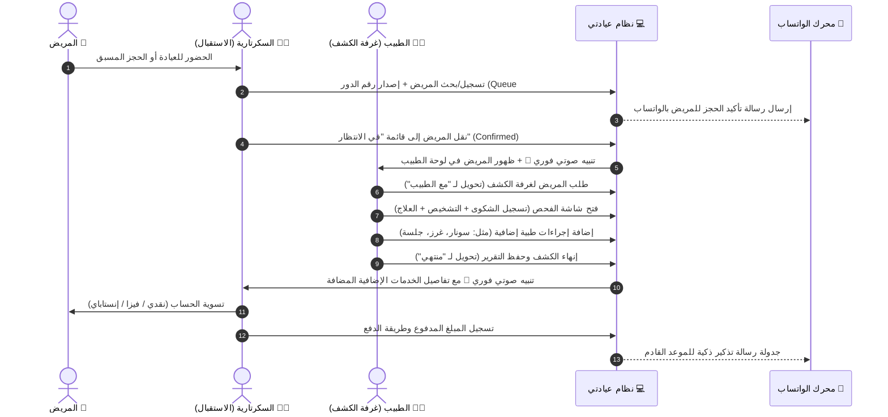

# 🩺 دليل مواصفات وتفاصيل المنتج وسير العمل التشغيلي (Product Specification & Operations)

هذا المستند هو المرجع التشغيلي والتجاري الكامل لنظام **عيادتي (Eyadaty)** — منصة إدارة العيادات والمراكز الطبية الخاصة السحابية (`SaaS Clinic Management Platform`).

---

## 🎯 1. الرؤية والقيمة المضافة للمنتج (Vision & Value Proposition)

### المشكلة التي يعالجها النظام:
- **فوضى غرف الانتظار وتكدس المرضى**: صعوبة تنظيم الطابور اليومي والجمع بين المرضى ذوي الحجز المسبق والمرضى الحاضرين مباشرة للعيادة (Walk-in).
- **انقطاع التواصل اللحظي بين الطبيب والاستقبال**: الاعتماد على النداء اليدوي أو الورقي المرهق لدخول وخروج المرضى وتحديد الخدمات الطبية المضافة.
- **تشتت السجلات الطبية والتاريخ المرضي**: صعوبة استرجاع روشتات المريض السابقة والتشخيصات أثناء وقت الكشف الضيق.
- **غياب التواصل الآلي مع المرضى وتكرار التخلف عن المواعيد (No-Show Rate)**: إهدار وقت العيادة بسبب نسيان المرضى لمواعيدهم.
- **غموض الإيرادات اليومية وتوزيعها**: غياب الرؤية الدقيقة لإيرادات الكشوفات والخدمات الإضافية وتوزيع طرق الدفع (كاش، فيزا، إنستاباي، فودافون كاش).

### القيمة المضافة لنظام "عيادتي":
نظام متكامل، سريع، وسهل الاستخدام صُمم خصيصاً لتمكين الطبيب المستقل وطاقم السكرتارية من إدارة العيادة بسلاسة فائقة، مع الحفاظ على التزامن التام والتنبيهات اللحظية، وتوثيق السجل الطبي في ثوانٍ، وأتمتة رسائل الواتساب بدون أي جهد إضافي.

---

## 👥 2. الشريحة المستهدفة ونموذج العيادة (Target Audience & Clinic Profile)

- **نوع العيادات**: العيادات التخصصية الفردية والمراكز الطبية الخاصة الصغيرة في مصر والشرق الأوسط (باطنة، أطفال، عظام، جلدية، جراحة، أسنان، نساء وتوليد، عيون، أنف وأذن... إلخ).
- **حجم فريق العمل لكل عيادة**: 1 إلى 3 مستخدمين (طبيب + 1-2 موظف استقبال وسكرتارية).
- **بيئة الاستخدام**: متصفح الويب (كمبيوتر مكتبي / لابتوب للاستقبال وغرفة الكشف) والأجهزة اللوحية والجوال.

---

## 🔄 3. رحلة المريض وسير العمل اليومي المتزامن (Synchronized Daily Patient Journey)

يعتمد نظام "عيادتي" على تدفق تشغيلي متزامن لحظياً بين مكتب الاستقبال (السكرتارية) وغرفة الكشف (الطبيب):

---

## 🩺 4. السجل الطبي الإلكتروني ومساحة الفحص (EMR & Clinical Workspace)

تم تصميم شاشة مساحة عمل الفحص (`ExaminationScreen`) لتمنح الطبيب سرعة فائقة في التوثيق دون تعقيد:

### 1️⃣ التقسيم الثلاثي المنظم للملاحظات:
- **الشكوى الرئيسية (Chief Complaint)**: سبب زيارة المريض والأعراض الحالية.
- **التشخيص الطبي (Diagnosis)**: التقييم والتشخيص الإكلينيكي للطبيب.
- **الإرشادات والأدوية (Prescription & Instructions)**: الخطة العلاجية، الأدوية، الجرعات، ومواعيد تناولها.

### 2️⃣ ربط الخدمات والإجراءات الإضافية بالحساب:
- يختار الطبيب الخدمات المنفذة أثناء الكشف (مثل: رسم قلب، تحليل سكر عشوائي، سونار، ضماد جروح) من قائمته المعرفة مسبقاً.
- تُضاف تكلفة الخدمات فوراً على إجمالي حساب المريض مع إرسال إشعار لحظي ومسموع لمكتب الاستقبال لتحصيل الرسوم.

### 3️⃣ شريط التاريخ المرضي الجانبي (Patient Medical History Sidebar):
- نافذة جانبية سريعة تتيح للطبيب مراجعة جميع زيارات المريض السابقة، تشخيصاته، والأدوية المصروفة له بضغطة زر واحدة أثناء الفحص دون مغادرة الشاشة.

---

## 📱 5. منظومة أتمتة الواتساب الذكية (WhatsApp Patient Experience)

يُمثل الواتساب القناة الأساسية لبناء الثقة وتقليل نسب غياب المرضى عن مواعيدهم:

| نوع الرسالة | التوقيت / المشغل | المحتوى والهدف |
| :--- | :--- | :--- |
| **تأكيد الحجز الفوري** | لحظة تسجيل الحجز أو استقبال المريض | ترحيب بالمريض + إرسال تاريخ ووقت الحجز واسم العيادة لضمان التوثيق. |
| **رسالة الاعتذار والإلغاء** | عند إلغاء الموعد لظرف طارئ | اعتذار رسمي ولبق للمريض مع إمكانية التنسيق لموعد بديل. |
| **التذكيرات المجدولة الذكية** | قبل الموعد بساعتين (أو 24 ساعة) | تنبيه المريض للاستعداد وتقليل نسبة التأخير أو عدم الحضور. |
| **الرسائل المخصصة المباشرة** | إجراء يدوي من ملف المريض أو الطابور | إرسال تعليمات طبية، متابعة حالة ما بعد الإجراء، أو تنبيه بالنتائج. |

### 🛡️ ميزات الأمان التقني للواتساب:
- **حماية الرقم من الحظر (Anti-Ban Queue)**: تأخير ذكي عشوائي (5-8 ثوانٍ) بين كل رسالة وأخرى لمحاكاة السلوك البشري الطبيعي.
- **ربط لمرة واحدة (Permanent Session)**: مسح رمز الـ QR لمرة واحدة فقط وحفظ مفاتيح الجلسة في السيرفر مع إعادة الاتصال الذاتي الدائم.

---

## 📊 6. التحليلات والتقارير المالية والذكاء التشغيلي (Financial & Analytics Intelligence)

لوحة تحكم مالية وإحصائية متقدمة مصممة لاتخاذ القرارات التشغيلية وتتبع أداء العيادة:

### 1️⃣ المؤشرات المالية اللحظية:
- إجمالي إيرادات اليوم، هذا الأسبوع، هذا الشهر، وفترات مخصصة (آخر 90 يوماً).
- تفصيل الإيرادات: إيراد الكشوفات الأساسية مقابل إيراد الخدمات والإجراءات الطبية المضافة.
- نسبة النمو المالي مقارنة بالفترات السابقة (+/- %).

### 2️⃣ تحليلات المرضى والزيارات:
- تفصيل إجمالي الزيارات وتصنيفها:
  - **المرضى الجدد (New Patients)** لأول مرة في العيادة.
  - **المرضى القدامى والمترددون (Returning Patients)** للمتابعة والاستشارة.
  - نسبة المواعيد المكتملة مقابل الملغاة.

### 3️⃣ تفصيل مصادر الإيرادات (Revenue Sources Breakdown):
- **إيرادات الكشوفات (Consultations Revenue)**: تجميع دقيق لإيرادات كل نوع كشف على حدة (مثل: كشف أول مرة، استشارة، إعادة) مع عدد الحالات ومتوسط الدخل.
- **إيرادات الخدمات والإجراءات الطبية (Services & Procedures Revenue)**: تجميع إيرادات الإجراءات المضافة أثناء الفحص (مثل: سونار، غرز، جلسات) مع عدد المرات المنجزة.
- **تحليل أوقات الذروة (Peak Times Analysis)**: رصد الساعات الأكثر ازدحاماً بالمرضى في العيادة لمساعدة الطبيب على تنظيم أوقات العمل.

### 4️⃣ حماية خصوصية الأرقام المالية:
- خيار كامل للطبيب لحجب شاشة التقارير المالية والألواح الإحصائية عن طاقم السكرتارية للحفاظ على سرية الإيرادات.

---

## 🏢 7. إدارة الفريق والصلاحيات ونموذج الاشتراكات (Team & SaaS Subscriptions)

### 1️⃣ نظام انضمام الفريق بكود الدعوة:
- يمتلك كل طبيب كود دعوة فريد مكون من 6 رموز (`Invite Code`).
- تسجل السكرتيرة حساباً جديداً وتدخل كود العيادة لتنضم تلقائياً للعيادة الصحيحة.

### 2️⃣ مصفوفة صلاحيات دقيقة للسكرتارية:
- تفعيل/تعطيل صلاحية حذف المواعيد.
- تفعيل/تعطيل صلاحية إلغاء المواعيد.
- تفعيل/تعطيل صلاحية الاطلاع على التاريخ المرضي والروشتات.
- تفعيل/تعطيل صلاحية تعديل أسعار الخدمات والكشوفات.
- تفعيل/تعطيل صلاحية رؤية التقارير المالية.
- إمكانية حظر الموظف فورياً بضغطة زر (`is_active = false`).

### 3️⃣ دورة حياة الاشتراكات وبوابات التجديد (Subscription Lifecycle):
- **فترة التفعيل المبدئية (`pending_activation`)**: مراجعة وتفعيل من المشرف العام.
- **الاشتراك الساري (`active`)**: وصول كامل لكافة خصائص النظام.
- **تنبيهات اقتراب الانتهاء**: شريط تنبيهي ذكي يوضح الأيام المتبقية مع زر لطلب التجديد.
- **بوابة الحجب عند انتهاء الاشتراك (`SubscriptionGateScreen`)**: شاشة واضحة تمنع الوصول للبيانات مع إتاحة سداد التجديد عبر وسائل الدفع السريعة (فودافون كاش، إنستاباي، تحويل بنكي) ومراسلة الإدارة لتأكيد التفعيل فوراً.
