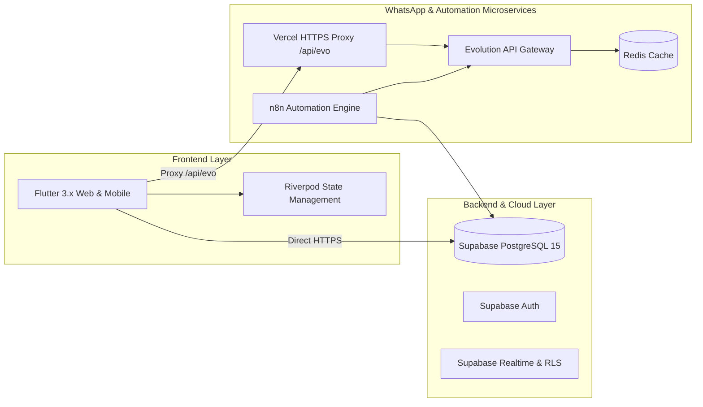

# 🏥 نظام عيادتي — Eyadaty Clinic Management SaaS

<div dir="rtl">

نظام سحابي متكامل ومتعدد المستأجرين (`Multi-Tenant`) لإدارة العيادات والمراكز الطبية الخاصة، مصمم لتسهيل عمليات الاستقبال، تنظيم طابور الكشف اليومي، التوثيق الطبي السريع، متابعة الإيرادات والتحليلات المالية، وأتمتة التواصل مع المرضى عبر رسائل `WhatsApp` الفورية.

---

## 🌟 الميزات التشغيلية والوظيفية (`Product Highlights`)

- **سير عمل متزامن لحظياً (`Synchronized Workflow`)**: ربط فوري بين شاشة الاستقبال وغرفة الكشف مع تنبيهات صوتية حية (`Sound Alerts`) عند دخول المريض أو انتهاء الكشف.
- **لوحة انتظار تفاعلية (`Live Queue Board`)**: تنظيم فوري للمرضى في غرف الانتظار وتحديث حالاتهم لحظياً وتوزيع أرقام الأدوار (`Queue Numbers`).
- **السجل الطبي ومساحة الفحص (`EMR & Examination Workspace`)**:
  - تقسيم ثلاثي منظم: الشكوى الرئيسية، التشخيص الطبي، والإرشادات والأدوية (الروشتة).
  - إضافة الإجراءات والخدمات الطبية المضافة (سونار، غرز، جلسات) مع إدراجها فورياً في فاتورة الاستقبال.
  - شريط جانبي لمراجعة التاريخ المرضي وزيارات المريض السابقة بنقرة واحدة.
- **أتمتة الواتساب الذكية (`WhatsApp Automation Engine`)**:
  - ربط دائم عبر مسح الرمز لمرة واحدة مع إعادة اتصال تلقائي.
  - رسائل تأكيد الحجز الفورية ورسائل الاعتذار عند الإلغاء.
  - تذكيرات مجدولة قبل موعد الكشف لتقليل نسبة التخلف عن الحضور.
  - طابور حماية ضد حظر الأرقام (`Anti-Ban Queue 5-8s`).
- **التقارير المالية والذكاء التشغيلي (`Financial Analytics`)**:
  - متابعة الإيرادات اللحظية مع نسب المقارنة.
  - مطابقة الخزينة والدرج اليومي (`Cash Drawer Reconciliation`) وتوثيق المصروفات النثرية (`Petty Cash`).
- **مصفوفة صلاحيات دقيقة وإدارة الفريق (`Team RBAC`)**:
  - انضمام السكرتارية عبر كود دعوة فريد (6 رموز).
  - تحكم كامل للطبيب في صلاحيات السكرتارية (إلغاء/حذف المواعيد، رؤية التقارير المالية، تعديل الأسعار، رؤية التاريخ الطبي).
- **بوابة الاشتراكات السحابية (`SaaS Subscription Gate`)**: دورة حياة متكاملة للاشتراكات (`pending_activation`، `active`، `expired`، `suspended`).

---

## 📚 التوثيق الهندسي والتقني المعتمد (`Engineering Documentation`)

- 🏛️ **[دليل المعمارية وهندسة النظام (docs/ARCHITECTURE.md)](./docs/ARCHITECTURE.md)**: شرح تفصيلي لهيكلية الطبقات (`Feature-First Layered Architecture`)، إدارة الحالة عبر `Riverpod`، عقد التنقل وفك الارتباط الصارم (`AppNavigation` & `AppRouter`).
- 🔒 **[دليل الأمان والعزل السحابي (docs/SECURITY.md)](./docs/SECURITY.md)**: العزل المتعدد للمستأجرين (`Multi-Tenant Isolation`)، سياسات `Row Level Security (RLS)`، ومصفوفة الصلاحيات (`RBAC`).
- 🎨 **[دليل التصميم والهوية البصرية (docs/THEMING_AND_UI_GUIDE.md)](./docs/THEMING_AND_UI_GUIDE.md)**: منظومة الرموز التصميمية (`Design Tokens`)، الخطوط (`Cairo` و `JetBrains Mono`)، معايير واجهات العيادات عالية الكثافة، وقواعد التنسيق ثنائي الاتجاه (`BiDi / RTL`).
- 🛠️ **[دليل تطوير الميزات وإعادة بناء الواجهات (docs/FEATURE_DEVELOPMENT_GUIDE.md)](./docs/FEATURE_DEVELOPMENT_GUIDE.md)**: الدليل الإرشادي خطوة بخطوة لإضافة ميزات جديدة أو إعادة بناء الواجهات بأمان تام دون كسر المنظومة.

---

</div>

## 🏗️ Tech Stack



<div dir="rtl">

---

## 🚀 دليل التشغيل والتحقق المحلي (`Getting Started & Verification`)

### 1. تثبيت الحزم
```bash
flutter pub get
```

### 2. فحص الجودة والتحليل الساكن (`Static Analysis`)
```bash
flutter analyze
```

### 3. تشغيل الاختبارات المؤتمتة (`Automated Tests`)
```bash
flutter test
```

### 4. التشغيل في بيئة التطوير
```bash
# تشغيل نسخة الويب
flutter run -d chrome

# تشغيل على أجهزة سطح المكتب أو الأجهزة الذكية
flutter run -d linux
```

---

*حقوق التطوير محفوظة © نظام عيادتي (`Eyadaty`).*

</div>
