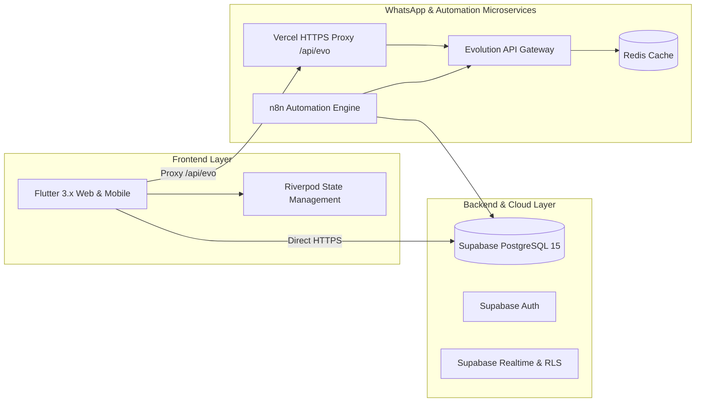

# 🏥 نظام عيادتي — Eyadaty Clinic Management SaaS

نظام سحابي متكامل ومتعدد المستأجرين (**Multi-Tenant**) لإدارة العيادات والمراكز الطبية الخاصة في مصر والشرق الأوسط، مصمم لتسهيل عمليات الاستقبال، تنظيم طابور الكشف اليومي، التوثيق الطبي السريع، متابعة الإيرادات والتحليلات المالية، وأتمتة التواصل مع المرضى عبر رسائل الواتساب الفورية.

---

## 🌟 الميزات التشغيلية والوظيفية (Product Highlights)

- **سير عمل متزامن لحظياً (Synchronized Workflow)**: ربط فوري بين شاشة الاستقبال وغرفة الكشف مع تنبيهات صوتية حية (`Sound Alerts`) عند دخول المريض أو انتهاء الكشف.
- **لوحة انتظار تفاعلية (Live Queue Board)**: تنظيم فوري للمرضى في غرف الانتظار وتحديث حالاتهم لحظياً وتوزيع أرقام الأدوار (Queue Numbers).
- **السجل الطبي ومساحة الفحص (EMR & Examination Workspace)**:
  - تقسيم ثلاثي منظم: الشكوى الرئيسية، التشخيص الطبي، والإرشادات والأدوية (الروشتة).
  - إضافة الإجراءات والخدمات الطبية المضافة (سونار، غرز، جلسات) مع إدراجها فورياً في فاتورة الاستقبال.
  - شريط جانبي لمراجعة التاريخ المرضي وزيارات المريض السابقة بنقرة واحدة.
- **أتمتة الواتساب الذكية (WhatsApp Automation Engine)**:
  - ربط دائم عبر مسح الرمز لمرة واحدة مع إعادة اتصال تلقائي.
  - رسائل تأكيد الحجز الفورية ورسائل الاعتذار عند الإلغاء.
  - تذكيرات مجدولة قبل موعد الكشف بساعتين (أو 24 ساعة) لتقليل نسبة التخلف عن الحضور.
  - طابور حماية ضد حظر الأرقام (Anti-Ban Queue 5-8s).
- **التقارير المالية والذكاء التشغيلي (Financial Analytics)**:
  - متابعة الإيرادات اللحظية (اليوم، الأسبوع، الشهر، وآخر 90 يوماً) مع نسب المقارنة.
  - تفصيل مصادر الإيرادات: إيراد الكشوفات الأساسية (Consultations) مقابل إيراد الخدمات والإجراءات الطبية المضافة (Procedures/Services) وتحليل أوقات الذروة.
- **مصفوفة صلاحيات دقيقة وإدارة الفريق (Team RBAC)**:
  - انضمام السكرتارية عبر كود دعوة فريد (6 رموز).
  - تحكم كامل للطبيب في صلاحيات السكرتارية (إلغاء/حذف المواعيد، رؤية التقارير المالية، تعديل الأسعار، رؤية التاريخ الطبي).
- **بوابة الاشتراكات السحابية (SaaS Subscription Gate)**: دورة حياة متكاملة للاشتراكات (`pending_activation`, `active`, `expired`, `suspended`) مع دعم السداد عبر وسائل الدفع المحلية.

---

## 🏗️ البنية التقنية (Tech Stack)



- **Frontend**: Flutter (Web, Android, iOS) مع `flutter_riverpod` لإدارة الحالة، وخط **Cairo** للهوية العربية.
- **Backend & Database**: **Supabase** (PostgreSQL 15 مع Row-Level Security و Realtime).
- **WhatsApp Engine**: **Evolution API** على سيرفر Hetzner VPS مع كاش **Redis 7** وقاعدة بيانات مستقلة.
- **الأتمتة والمهام المجدولة**: **n8n Workflow Engine**.
- **الاستضافة**: **Vercel** لتطبيق الويب، و **Hetzner VPS** مع **Coolify / Docker Compose** للخدمات المساندة.

---

## 📚 أدلة ومستندات المشروع المتخصصة

للحصول على تفاصيل دقيقة لكل جانب من جوانب النظام، يُرجى مراجعة المستندات التالية:

1. 🚀 [وثيقة معمارية ومواصفات المرحلة الثانية (PHASE_2_SPECIFICATION.md)](./PHASE_2_SPECIFICATION.md):
   - تعدد الفروع، تعدد الأطباء، ومساحات العمل الإكلينيكية التخصصية (أطفال، رمد، باطنة، صدر، وبيطري) مع معايير الـ SaaS الإنتاجي.
2. 🩺 [دليل مواصفات وتفاصيل المنتج وسير العمل التشغيلي (PRODUCT_SPECIFICATION.md)](./PRODUCT_SPECIFICATION.md):
   - الرؤية التشغيلية، رحلة المريض، مساحة الفحص الأساسية، أتمتة الواتساب، والتحليلات المالية ونموذج الاشتراكات.
3. 🗄️ [دليل معمارية قاعدة البيانات والأمان (DATABASE_ARCHITECTURE.md)](./DATABASE_ARCHITECTURE.md):
   - تفاصيل الجداول، سياسات RLS، مصفوفة الصلاحيات، ودورة حياة الاشتراكات.
4. 📗 [دليل معمارية سيرفر الواتساب (WHATSAPP_SERVER_ARCHITECTURE.md)](./WHATSAPP_SERVER_ARCHITECTURE.md):
   - بيانات سيرفر Hetzner، المنافذ (8081 / 5679)، محرك الأتمتة n8n، وطابور الحماية من الحظر.
5. 🎨 [دليل نظام التصميم والواجهات (DESIGN.md)](./DESIGN.md):
   - فلسفة التصميم الطبي، لوحة الألوان الرسمية، قواعد التايبوجرافي، وأنماط المكونات.
6. 🌟 [دليل الهوية البصرية والإعلانات (Visual identity/BRAND_IDENTITY.md)](./Visual%20identity/BRAND_IDENTITY.md):
   - برومبتات الذكاء الاصطناعي لتصميم البوسترات والإعلانات، وتنسيقات الألوان والأصول.

---

## 🚀 دليل التشغيل والتطوير المحلي (Getting Started)

### 1. المتطلبات الأساسية
- Flutter SDK (الإصدار 3.22+ أو أحدث).
- حساب Supabase أو مشروع محلي.
- بيئة خادم تدعم Docker لتشغيل بوابة الواتساب.

### 2. تثبيت الحزم
```bash
flutter pub get
```

### 3. إعداد متغيرات البيئة
تأكد من إعداد ملف `.env` أو تمرير القيم عبر `--dart-define`:
```bash
SUPABASE_URL=https://sgbfmqplryyhypdvrlmn.supabase.co
SUPABASE_ANON_KEY=your_supabase_anon_key
EVO_API_KEY=your_evolution_api_key
```

### 4. التشغيل في بيئة التطوير
```bash
# تشغيل نسخة الويب
flutter run -d chrome

# تشغيل على محاكي أندرويد
flutter run -d android
```

### 5. بناء نسخة الإنتاج للويب (Production Build)
```bash
flutter build web --release --web-renderer canvaskit
```

---

## 🔒 الأمان وحماية البيانات
- **عزل كامل لبيانات العيادات**: يتم تطبيق العزل تلقائياً من خلال `auth.uid()` ومطابقته مع `users.clinic_id` داخل PostgreSQL RLS.
- **حماية التقارير المالية والروشتات**: صلاحيات دقيقة تمنع وصول السكرتارية للبيانات الحساسة حسب رغبة الطبيب.
- **سجلات التدقيق (Audit Logs)**: تسجيل التعديلات الحساسة لضمان الشفافية والامتثال الطبي.

---

*حقوق التطوير محفوظة © نظام عيادتي (Eyadaty).*
