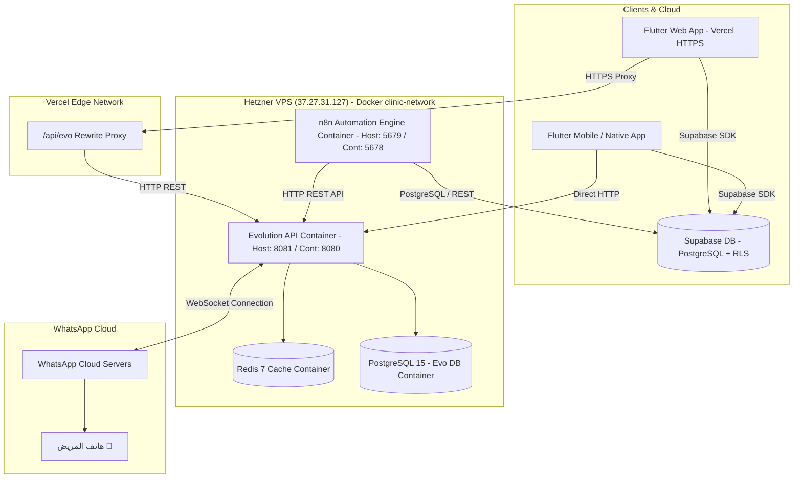

# 📗 دليل المعمارية التقنية وسيرفر أتمتة الواتساب (WhatsApp Automation Architecture)

هذا المستند يُعد المرجع الهندسي والتقني الكامل لتشغيل وإدارة سيرفر الواتساب الخاص بنظام إدارة العيادات (`Clinic SaaS — عيادتي`).

---

## 🎯 1. بيانات السيرفر والبيئة البرمجية (Server & Environment Details)

| البيان | القيمة / التفاصيل | ملاحظات |
| :--- | :--- | :--- |
| **مضيف السيرفر (Hosting)** | Hetzner VPS (Ubuntu) | خادم مخصص عالي الأداء |
| **عنوان الـ IP** | `37.27.31.127` | IP السيرفر الرئيسي |
| **إدارة السيرفر** | **Coolify** / Docker Compose | تشغيل وإدارة الحاويات تلقائياً |
| **رابط التطبيق (Vercel Frontend)** | `https://eyadaty.vercel.app/` | واجهة الويب مع SSL نشط |
| **رابط مشروع Supabase** | `https://sgbfmqplryyhypdvrlmn.supabase.co` | قاعدة بيانات Postgres + Auth + RLS |
| **منفذ بوابة Evolution API** | `8081` (Host) ⬅️ `8080` (Container) | `http://37.27.31.127:8081` |
| **منفذ محرك الأتمتة n8n** | `5679` (Host) ⬅️ `5678` (Container) | `http://37.27.31.127:5679` |
| **مسار البروكسي (Vercel Proxy)** | `/api/evo/:path*` ⬅️ `http://37.27.31.127:8081/:path*` | لمنع مشاكل CORS و Mixed Content على الويب |

---

## 🏗️ 2. المكونات التقنية للبنية التحتية (Infrastructure Stack)

يعمل السيرفر باستخدام **Docker Compose** (مباشرة أو عبر Coolify Stack) داخل شبكة معزولة وخاصة (`clinic-network`).



---

## ⚡ 3. الميزات الهندسية وحلول الأمان (Key Engineering Features)

### 1️⃣ ربط دائم بدون تكرار مسح الـ QR Code (Permanent WhatsApp Session)
- **كيف تعمل؟** تم ربط محرك Evolution API بقاعدة بيانات `clinic_db_evo` (Postgres) ومحرك التخزين المؤقت `clinic_redis_evo` (Redis).
- **النتيجة**: يتم حفظ رموز الجلسة ومفاتيح التشفير بشكل دائم. عند إعادة تشغيل السيرفر أو انقطاع الإنترنت المؤقت عن هاتف العيادة، يُعيد النظام الاتصال ذاتياً (Auto Reconnect) دون الحاجة لمسح الـ QR Code مرة أخرى. العيادة تربط حسابها **مرة واحدة فقط**.

### 2️⃣ وضع النوم التلقائي للجلسات الخاملة (Auto-Sleep Mode)
- **الإعدادات المفعلة**:
  ```env
  INSTANCE_AUTO_CLOSE=true
  INSTANCE_AUTO_CLOSE_INTERVAL=15
  INSTANCE_AUTO_HELPER_CLEANUP=true
  ```
- **النتيجة**: عند خمول العيادة لمدة 15 دقيقة بدون إرسال رسائل، تُغلق الجلسة في الذاكرة (RAM) تلقائياً لتوفير موارد السيرفر. وعند طلب إرسال رسالة تذكير أو تأكيد، يقوم التطبيق بمحاولة إرسال الرسالة؛ وإذا كانت الجلسة نائمة، يوقظها تلقائياً (`/instance/connect/:instance`) خلال ثوانٍ معدودة ويرسل الرسالة ثم تعود للنوم.

### 3️⃣ طابور الحماية من الحظر والضغط (Anti-Ban & Rate Limiting Queue)
- **في كود التطبيق (`whatsapp_service.dart`)**:
  - **طابور خاص بكل عيادة (Per-Instance Queue)**: تأخير عشوائي بين 5 إلى 8 ثوانٍ بين الرسائل المتتالية لنفس العيادة لمحاكاة السلوك البشري الطبيعي وحماية أرقام الأطباء من الحظر عند الإلغاءات أو التذكيرات الجماعية.
  - **خانق المعالج العام (Global CPU Throttle)**: تأخير 500ms كحد أدنى بين أي طلبات HTTP مختلفة لحماية معالج السيرفر.

---

## 📂 4. ملفات سير عمل الأتمتة (n8n Workflows)

يحتوي المشروع على ملفات سير عمل جاهزة للاستيراد في n8n:
1. **`Eyadaty - Zero-RAM WhatsApp Reminders (Ultra Speed).json`**:
   - محرك إرسال التذكيرات التلقائية للمواعيد القادمة غداً.
   - يتصل بـ Supabase مباشرة لجلب مواعيد الغد المؤكدة للعيادات المفعلة لخدمة الواتساب.
   - يقوم بإرسال نص القالب المخصص (`reminder_message_template`) عبر Evolution API دون استهلاك موارد الذاكرة.
2. **`n8n_whatsapp_workflow.json`**:
   - مخطط سير العمل الاحتياطي لمعالجة الرسائل والتأكيدات اللحظية.

---

## 🛠️ 5. كيفية التشغيل والتثبيت عبر Coolify أو Docker Compose

### الخيار 1: التشغيل الفوري عبر Coolify (موصى به)
1. افتح لوحة تحكم **Coolify** من المتصفح.
2. اختر **Projects** ⬅️ **New Resource** ⬅️ **Docker Compose**.
3. انسخ محتوى ملف `docker-compose.yml` والصقه في Coolify.
4. في قسم المتغيرات البيئية (Environment Variables)، أضف المتغيرات من ملف `.env`.
5. اضغط **Deploy**. سيقوم Coolify بتشغيل الحاويات وتوفير الحماية وإعادة التشغيل التلقائي عند أي عطل.

### الخيار 2: التشغيل المباشر عبر SSH
```bash
# الاتصال بالسيرفر
ssh root@37.27.31.127

# الانتقال لمجلد المشروع وتعديل الملفات
cd /path/to/Clinic

# تشغيل جميع الحاويات في الخلفية
docker compose up -d

# التحقق من حالة الحاويات
docker ps
```
