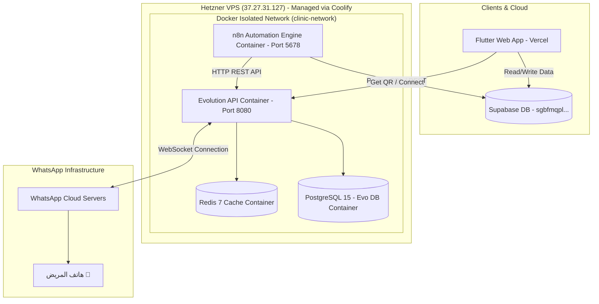

# 📗 دليل المعمارية التقنية وسيرفر أتمتة الواتساب (WhatsApp Automation Architecture)

هذا المستند يُعد المرجع الهندسي والتقني الكامل لتشغيل وإدارة سيرفر الواتساب الخاص بنظام إدارة العيادات (`Clinic SaaS`).

---

## 🎯 1. بيانات السيرفر والمشروع (Server & Environment Details)

| البيان | القيمة / التفاصيل |
| :--- | :--- |
| **مضيف السيرفر (Hosting)** | Hetzner VPS (Ubuntu) |
| **عنوان الـ IP** | `37.27.31.127` |
| **ملاحظة الإدارة** | مثبت عليه لوحة التحكم **Coolify** |
| **رابط التطبيق (Vercel Frontend)** | `https://eyadaty.vercel.app/` |
| **رابط مشروع Supabase** | `https://sgbfmqplryyhypdvrlmn.supabase.co` |
| **مفتاح Supabase Service Role** | تم تكوينه في `.env` لأتمتة n8n بالكامل |
| **رابط بوابة Evolution API** | `http://37.27.31.127:8080` |
| **رابط محرك n8n** | `http://37.27.31.127:5678` |

---

## 🏗️ 2. المكونات التقنية للبنية التحتية (Infrastructure Stack)

يعمل السيرفر باستخدام **Docker Compose** (مباشرة أو عبر Coolify Stack) داخل شبكة معزولة وخاصة (`clinic-network`).



---

## ⚡ 3. حل المشاكل الرئيسية (Key Architectural Solutions)

### 1️⃣ ربط دائم بدون تكرار مسح الـ QR Code (Permanent WhatsApp Session)
- **كيف تم حلها؟** تم ربط محرك Evolution API بقاعدة بيانات `db_evo` وكاش `redis_evo`.
- **النتيجة**: يتم حفظ رموز الجلسة ومفاتيح التشفير دائمياً في قاعدة البيانات. عند إعادة تشغيل السيرفر أو انقطاع الإنترنت المؤقت عن الهاتف، يُعيد النظام الاتصال ذاتياً (Auto Reconnect) دون الحاجة لمسح الـ QR Code مرة أخرى. الطبيب يربط حسابه **مرة واحدة فقط**.

### 2️⃣ ميزة "النوم التلقائي" للجلسات (Auto-Sleep Mode)
- **كيف تم حلها؟** تم تفعيل الإعدادات الآتية في السيرفر:
  ```env
  INSTANCE_AUTO_CLOSE=true
  INSTANCE_AUTO_CLOSE_INTERVAL=5
  INSTANCE_AUTO_HELPER_CLEANUP=true
  ```
- **النتيجة**: عند خمول العيادة لمدة 5 دقائق بدون إرسال رسائل، تُغلق الجلسة في الرام (RAM) تلقائياً لتفريغ المساحة. وعند طلب إرسال رسالة تذكير أو تأكيد، تستيقظ الجلسة تلقائياً في **أقل من ثانية واحدة**، ترسل الرسالة وتعود للنوم.

---

## 🛠️ 4. كيفية التشغيل والتثبيت عبر Coolify أو Docker Compose

### الخيار 1: التشغيل الفوري عبر Coolify (موصى به):
1. افتح لوحة تحكم **Coolify** من المتصفح الخاص بك.
2. اختر **Projects** ⬅️ **New Resource** ⬅️ اختر **Docker Compose**.
3. قم بنسخ محتوى ملف `docker-compose.yml` ولصقه في Coolify.
4. في قسم المتغيرات البيئية (Environment Variables) في Coolify، انسخ محتوى ملف `.env`.
5. اضغط **Deploy**. سيقوم Coolify بتشغيل الخدمات الأربع وتوفير حماية وإعادة تشغيل تلقائي.

### الخيار 2: التشغيل المباشر عبر SSH:
```bash
# الاتصال بالسيرفر
ssh root@37.27.31.127

# الانتقال لمجلد المشروع وتعديل الملفات
cd /path/to/Clinic

# تشغيل جميع الحاويات
docker-compose up -d
```

---
*تم تحديث المستند ببيانات سيرفر Hetzner ومروع Supabase و Vercel.*
